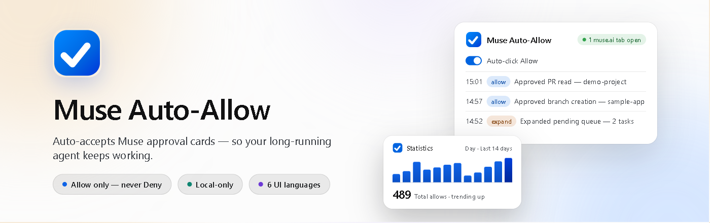
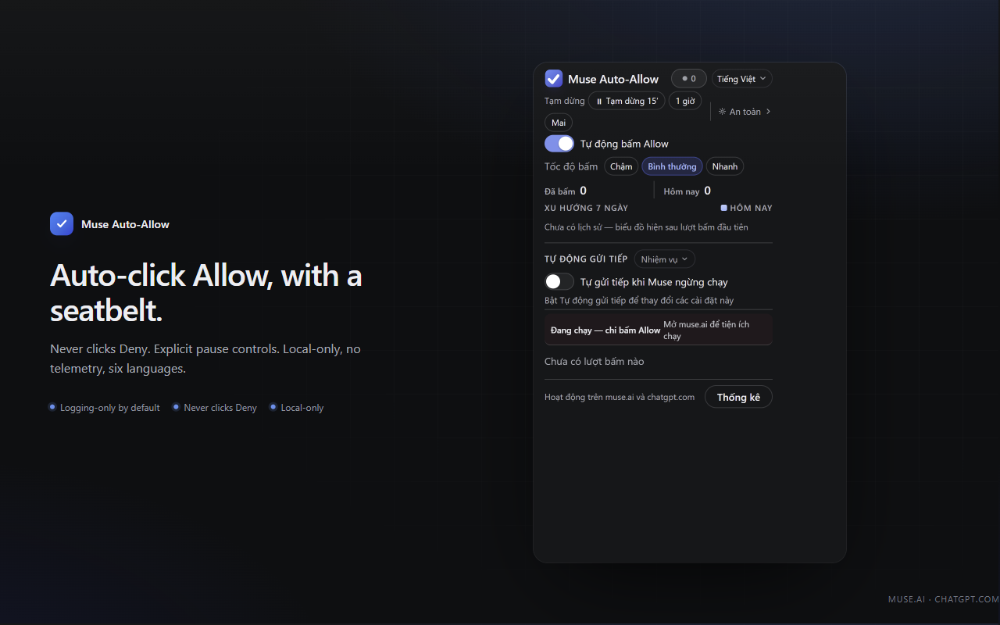
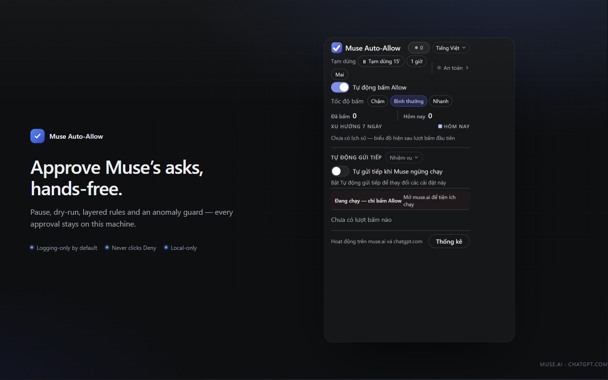
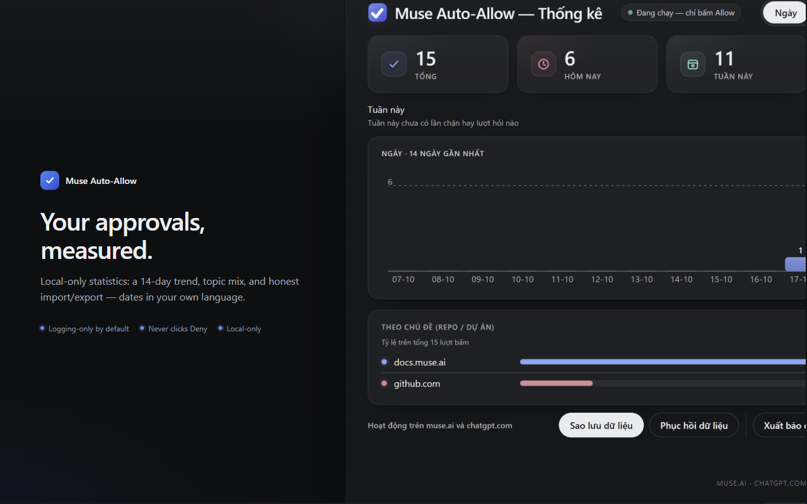
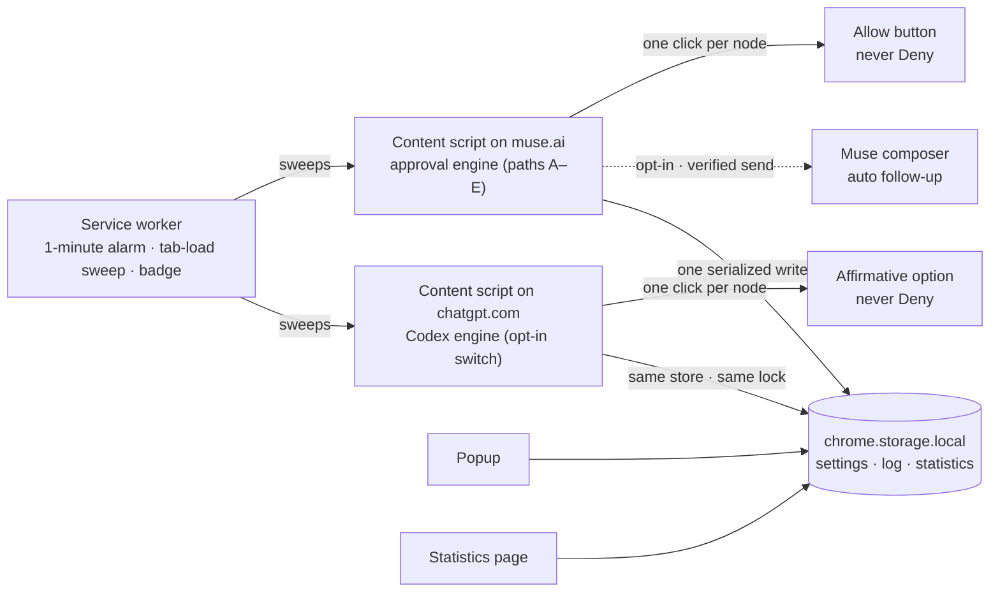

<div align="center">
  
</div>

<div align="center">

[](https://github.com/BlueSkyz-Labs/muse-auto-allow/actions/workflows/ci.yml)
[](https://github.com/BlueSkyz-Labs/muse-auto-allow/releases/latest)
[](LICENSE)
[](https://developer.chrome.com/docs/extensions/reference/manifest/minimum-chrome-version)
[](CONTRIBUTING.md)

**Auto-accepts Muse approval cards — and, with its own opt-in switch, Codex (ChatGPT) requests — so your long-running agents keep working while you're away.**

</div>

Muse Auto-Allow is a zero-dependency Chrome (Manifest V3) extension that clicks **Allow** on
[Muse](https://muse.ai) approval requests — and the affirmative option on **Codex (ChatGPT)**
approval requests on chatgpt.com, behind a separate switch that ships off — so your agents keep
running instead of waiting on you. It never clicks **Deny**, never clicks a lone **Allow**, and
sends nothing to the developer or to any remote server.

---

## Why

Muse pauses mid-task to ask for permission — *"Allow Muse to perform this action on your GitHub
account?"* — and the run stops until somebody clicks **Allow**. Step away for a meeting and your
agent can sit for hours on a card nobody saw.

Muse Auto-Allow watches the page and clicks **Allow** the moment an approval card appears, so
long-running work continues while you're away. Everything else it does is deliberately
conservative — the full list is below. Optionally, **Auto follow-up** (off by default) also keeps
Muse itself moving: when its status line reads *Connected* and stays idle, the extension sends a
prompt you composed from a phrase library, so the agent continues on its own.

The same problem exists one surface over: **Codex (ChatGPT)** stops a cloud task when it asks for
approval — *"Yes, proceed"* / *"No, and tell Codex what to do differently"* — and the run waits on
you. **Codex (ChatGPT)** is a separate, opt-in engine for exactly that (its own switch, off by
default), with the same conservative rails; details: [`docs/CODEX.md`](docs/CODEX.md).

## Screenshots

<p align="center">
  
</p>

**The popup.** On/off toggle, click delay, today's counter, the live click log, the Codex
(ChatGPT) switch, and the opt-in Auto follow-up builder.

<p align="center">
  
</p>

**In context.** Approval cards on muse.ai, clicked automatically — Allow only, never Deny — with
the popup alongside.

<p align="center">
  
</p>

**Statistics.** Clicks by day / week / month / year and by topic (Muse topics and `chatgpt.com`
separate at a glance), plus JSON export & import.

> All demo data in public assets is fictional. Asset inventory and regenerate commands:
> [`store/SHOWCASE.md`](store/SHOWCASE.md).

## Features

### Auto-approve that keeps the run alive (muse.ai)

Approval surfaces are found five ways, in priority order:

1. **Marked cards** — `data-testid="hatch-inline-approval-card"` elements containing an allow-ish
   and a deny-ish button.
2. **Allow/Deny pairs** — an `Allow` button whose nearest ancestor holds exactly one allow-ish
   button and a deny-ish counterpart.
3. **Collapsed pending cards** — *"Allow Muse to perform this action…"* cards are expanded first,
   then the revealed pair is approved.
4. **The approvals banner** — *"N tasks need your approval"* is clicked to open the approvals
   panel, so pending cards can render.
5. **The chat-level review bar** — *"A task needs review"* is clicked so the approval panel
   appears, and the pair is approved on the next sweep.

Clicks are paced by a configurable delay, and every click is recorded — kind, label, context,
timestamp (last 50) — and shown in the popup.

### Codex (ChatGPT) — a separate, opt-in engine (chatgpt.com)

Its **own switch** — in the popup's **Safety & Control** panel, next to YOLO (default
**off**; with it off, chatgpt.com is untouched — no
click, no log entry). The engine follows the shipped Codex vocabulary — *"Yes, proceed"*,
*"Allow"*, *"Approve"*, one-shot forms preferred — and finds requests three ways:

1. **Affirmative/negative pairs** — an affirmative option whose SAME button container holds a
   clickable negative counterpart (a lone affirmative is never clicked).
2. **Collapsed pending cards** — *"Allow Codex to …"* is expanded first; the revealed pair is
   approved on the next sweep.
3. **Review bars** — *"A task needs your approval"* + **Review** opens the approvals panel.

Standing grants (*"Always allow"*, *"Yes, and don't ask again…"*) stay **manual** — no silent
scope escalation — except under the explicit YOLO opt-in. Auth/connector surfaces (Connect,
Authorize, link account, API key/token wording) are hard-blocked container-wide; consent wording
is never overridden; the shared keyword block-list and the rate caps/cooldowns apply. Matching is
English-label based and fails closed. Contract, rails, evidence and honest limits:
[`docs/CODEX.md`](docs/CODEX.md).

### Safety rails — the parts that must never go wrong

- **Never clicks Deny** — or Reject, or Decline, or No, or any destructive counterpart, anywhere
  (Muse cards and Codex cards alike).
- **Never clicks a lone Allow** — only an affirmative that is part of a real affirmative/negative
  pair. Permission banners and prefix matches like "Allow notifications" are never clicked.
- **Consent cards fail closed** — notifications, camera, microphone, location, clipboard,
  newsletter/subscribe/marketing prompts are skipped; approval wording can never override the
  consent filter.
- **No silent scope escalation** — standing grants ("Always allow", "Allow for this site/task",
  "don't ask again") are deliberately not auto-clicked (the opt-in YOLO mode below is the one
  explicit exception; it ships off).
- **One click per element** (WeakSet), a 5-second re-render dedup, and per-text cooldowns — no
  pathological loops.
- **Hard rate caps** — at most 30 affirmative clicks per minute; expand / open-panel clicks are
  capped the same way.
- **Fail closed** — unknown or ambiguous state means do nothing.
- **Two scopes, both guarded** — muse.ai for the Muse engine, chatgpt.com for the Codex engine;
  each content script carries a hard hostname guard behind its manifest match, and the extension
  runs nowhere else.
- **YOLO mode — explicit opt-in, off by default** — for power users: bypasses the keyword
  block-list, clicks standing grants, caps pacing at 100 ms. Deny is still never clicked,
  connector surfaces stay hard-blocked, and the consent filters stay in force.

### Auto follow-up — keep Muse working (opt-in, default off)

When Muse goes idle — its status reads *Connected*, not *is working* — the extension can send a
follow-up prompt into the chat composer so the agent continues. The engine is guarded end to end:

- Idle must hold **continuously for 60 seconds** before anything is sent (configurable).
- **Never sends while an approval card or bar is present**, or while a draft sits in the composer.
- **Per-tab cooldown (10 min) and a hard cap of 6 automatic sends per hour.**
- A send only counts after the composer **verifiably clears** — a blocked or failed send is
  retried, never skipped.
- Busy-wins, fail-closed state detection: unknown means no send.

**Phrase library + rotation (v1.7.0).** Compose the follow-up from **8 groups** of ready-made
directives — continue, verify, quality, workflow, scope, report, security, design/UX — with
multi-select chips and a live preview of the exact string that will be sent. The three classic
presets remain as one-tap quick combos, custom text is appended, and saved combos can be sent
**round-robin**: the rotation index advances only after a verified send, so a prompt is never
skipped. Rationale and recommended combos: [`docs/PROMPT_LIBRARY.md`](docs/PROMPT_LIBRARY.md);
engine details and limitations: [`docs/FOLLOWUP.md`](docs/FOLLOWUP.md).

### Statistics, logs, and your data

- **Statistics page** — dependency-free inline SVG: clicks by day / week / month / year and **by
  topic** (the repository or host taken from each approval's context), KPI cards, and a
  top-topics list.
- **Popup** — today's count, a 7-day mini chart; the toolbar badge shows today's clicks.
- **Bounded by design** — the click log keeps the last 50 entries; aggregates keep 400 days /
  24 months / 100 topics.
- **Encrypted at rest** — the approval text in the log is AES-GCM-256 encrypted with a per-install
  key. Honest scope: it protects against casual profile inspection, not a full local attacker.
- **Backup & restore** — one JSON export/import from the Statistics page; imports are sanitized
  (typed whitelist, size caps) and key rotation is proof-gated.
- **Upgrade-safe** — a `schemaVersion` stamp travels with every write; earlier data shapes stay
  readable, so nothing is dropped on upgrade.

### Built for Muse — and for you

- **Muse design language** — light-first surfaces, pill controls, tight-tracked type, with a full
  dark theme and `prefers-reduced-motion` respected everywhere.
- **Six UI languages** — English, Tiếng Việt, 简体中文, 日本語, 한국어, Español (popup + manifest).
- **An original mark** — a white check on the brand-gradient tile, deliberately not Muse's or
  Meta's trademark (see [`docs/BRANDING.md`](docs/BRANDING.md)).

## Install

**Chrome Web Store:** not published yet — the submission pack is ready and the listing is being
prepared ([`store/CWS_SUBMISSION_PACK.md`](store/CWS_SUBMISSION_PACK.md)). Until it goes live,
install unpacked:

1. Download or clone this repository.
2. Open `chrome://extensions` and enable **Developer mode**.
3. Click **Load unpacked** and select the `extension/` directory (the manifest sits at its root).
4. Open or refresh a **muse.ai** tab so the content script injects — the toolbar popup shows
   status, the toggle, the counter, and the log. For the Codex engine, turn on **Codex (ChatGPT)**
   in the popup's **Safety & Control** panel (a **"Codex" chip** appears on the Safety entry)
   and refresh a **chatgpt.com** tab.

Requires **Chrome 116+** (`minimum_chrome_version` in the manifest). Nothing else — no build
step, no dependencies. Packaged builds ship on
[GitHub Releases](https://github.com/BlueSkyz-Labs/muse-auto-allow/releases/latest) (deterministic
zip + SHA256 sidecar).

## How it works



- **Content script** (`extension/content.js`) — runs only on muse.ai pages; on a 1-second
  heartbeat it scans for the five approval surfaces above, clicks through the safety rails,
  records every click in one serialized storage write, and runs the opt-in follow-up engine.
- **Codex content script** (`extension/codex.js`) — runs only on chatgpt.com pages; sweeps the
  three Codex paths above behind its own `codexEnabled` switch, writes through the SAME
  serialized flush and Web Lock as the Muse engine, and halts on pause/dry-run exactly like it.
- **Service worker** (`extension/background.js`) — a once-a-minute alarm plus a sweep when a
  muse.ai (or chatgpt.com) tab finishes loading; keeps the toolbar badge current and runs
  versioned, idempotent storage migrations.
- **Popup + Statistics page** — the control surface and the dashboard; both read and write the
  same `chrome.storage.local` store.
- **Storage** — settings, the last 50 clicks (approval text encrypted), counters,
  day/month/year/topic aggregates, and a `schemaVersion` stamp. Local by default; the optional,
  off-by-default "Sync settings across devices" switch mirrors settings (never the log) through
  Chrome Sync — nothing is sent to the developer.

## Privacy & Security

- **Local-only, by construction.** No servers, no analytics, no telemetry. The extension makes no
  network calls and loads no remote code — a zero-dependency lint gate
  ([`scripts/lint.mjs`](scripts/lint.mjs)) fails the build if `fetch`, `XMLHttpRequest`,
  `WebSocket`, `importScripts`, `eval`, or a remote `<script src>` ever appears in the extension
  source.
- **Minimal permissions.** `storage` + `alarms`, and host access pinned to `https://muse.ai/*` +
  `https://*.muse.ai/*` (Muse engine) and `https://chatgpt.com/*` + `https://*.chatgpt.com/*`
  (Codex engine, opt-in) — no `tabs`, `scripting`, `webRequest`, `cookies`, or `<all_urls>`; the
  lint gate pins both host sets and each engine's `content_scripts` match exactly.
- **Encrypted at rest, with documented limits.** The log-encryption key lives in the same local
  store as the data — that protects casual profile inspection, not a full local attacker, and it
  is written down rather than hidden.
- **Security round (v1.7.0).** An internal attack-chain audit, fixes with falsification harnesses
  ([`test/import-security.mjs`](test/import-security.mjs)), then an **independent re-attack
  (maker ≠ judge)** that confirmed every fix:
  [`docs/SECURITY_REMEDIATION.md`](docs/SECURITY_REMEDIATION.md),
  [`docs/SECURITY_REATTACK.md`](docs/SECURITY_REATTACK.md).
- **Reporting.** Please report vulnerabilities privately — see [`SECURITY.md`](SECURITY.md).
- **Privacy policy** — <https://blueskyz-labs.github.io/muse-auto-allow/privacy.html>.

## Development

Zero dependencies, no build step: plain JavaScript, no bundler, no `node_modules`. The shipped
bytes are the reviewed bytes.

**Requirements:** Node.js ≥ 22 (CI pins 24) · Python 3 (only for `scripts/verify-zip.py`) ·
Chrome 116+ for the extension; the E2E harnesses need Chrome 137+.

| Command | What it proves |
|---|---|
| `node scripts/lint.mjs` | JS syntax + JSON validity, i18n key parity across all six locales, no remote-code or network primitives, manifest hygiene (MV3, permission allowlist, the two pinned host sets, per-engine `content_scripts` matches, the shared `BLOCK_SEED` lockstep, explicit CSP) |
| `node test/e2e.mjs` | Real-Chrome E2E of the Muse approval paths + safety invariants — never Deny, never lone Allow, one click per node, dedupe (scratch profile only) |
| `node test/codex-e2e.mjs` | Real-Chrome E2E of the Codex (ChatGPT) engine: the off-switch is dormant, dry-run logs only, the pair/expand/review-bar paths click, the forbidden set is never touched, YOLO branch, encrypted-at-rest store contract |
| `node test/followup-e2e.mjs` | Real-Chrome E2E of the follow-up engine and popup builder: idle waits, cooldowns, guards, rotation |
| `node test/background-unit.mjs` | Service-worker contract without a browser: pause badge + commands + digest + sync subset (incl. the chatgpt.com nudge filtering) + migrations |
| `node test/import-security.mjs` | Falsification harness for the backup-import path (key-rotation proof, sanitization, bounds) |
| `node scripts/build.mjs` + `python scripts/verify-zip.py` | Deterministic store zip + SHA256 sidecar, byte-verified against `extension/` |
| `node scripts/smoke-zip.mjs` | Extracts the built zip and proves the artifact passes the core E2E in a scratch Chrome |

The E2E harnesses drive an **installed** Chrome over CDP with a scratch profile — they never
touch your real browser profile. They currently launch Chrome through Windows PowerShell, so
they run on Windows locally (CI runs them on `windows-latest`); a POSIX launch path is a welcome
contribution. Full details: [`CONTRIBUTING.md`](CONTRIBUTING.md); applied Chrome best-practices
checklist: [`docs/CHROME_BEST_PRACTICES.md`](docs/CHROME_BEST_PRACTICES.md); release engineering:
[`docs/RELEASE_INTEGRITY.md`](docs/RELEASE_INTEGRITY.md).

```
extension/   the loadable MV3 extension (manifest at its root): two content scripts (Muse + Codex)
             + service worker, popup, Statistics page, icons, 6 locales
test/        real-Chrome E2E harnesses (approval paths, Codex engine, follow-up engine,
             import security) + fixtures
scripts/     lint gate, deterministic build + verify, artifact smoke test, asset renderers
assets/      HTML sources for every rendered asset (icons, store images, README hero)
store/       Chrome Web Store kit: listing copy, privacy, runbooks, compliance, screenshots
docs/        follow-up engine + phrase library, Codex engine contract, brand kit, security round,
             release integrity
```

## Contributing

PRs are welcome. The bar: keep it zero-dependency, keep the safety invariants intact (they *are*
the product), and prove new guards with tests that fail without them. Start with
[`CONTRIBUTING.md`](CONTRIBUTING.md); security issues go through [`SECURITY.md`](SECURITY.md),
never a public issue.

## License

[MIT](LICENSE) © 2026 BlueSkyz Labs — **a BlueSkyz Labs product.**

**Unofficial and independent.** Muse Auto-Allow is an unofficial companion tool for Muse
(muse.ai) and Codex (ChatGPT); it is not affiliated with, endorsed by, or sponsored by Meta or
OpenAI. "Muse" and "Meta" are trademarks of their respective owners; "ChatGPT" and "Codex" are
trademarks of OpenAI — used here only to describe what the extension works with. It automates
clicking **Allow** (muse.ai) and the affirmative option (Codex cards on chatgpt.com) in your own
browser session, on your own account — make sure that fits how you use Muse and Codex before
enabling it.
